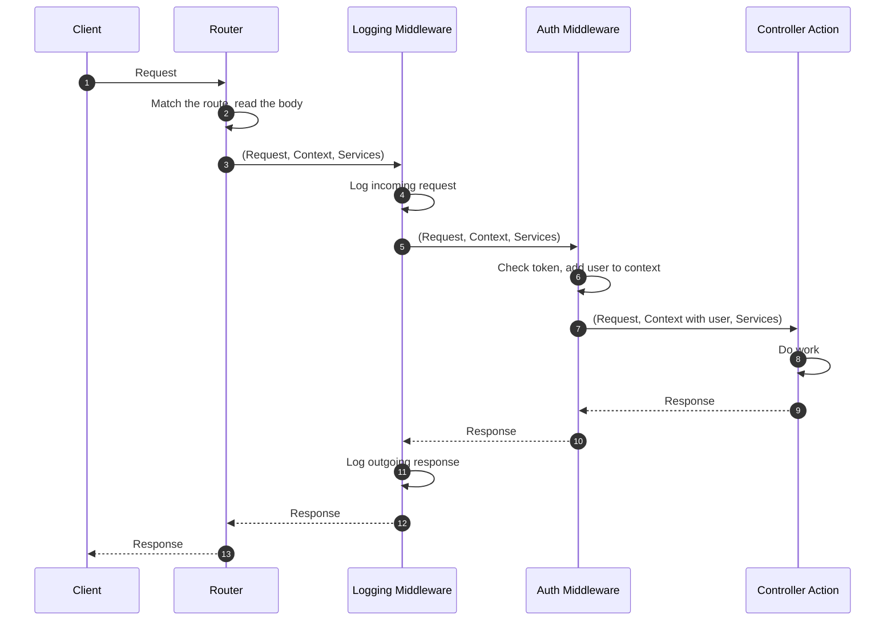

# How Dream Works

**Understanding the request flow from arrival to response.**

When a request arrives at your Dream server, here's exactly what happens:

## The Flow

```text illustration
1. Request arrives
2. Router matches path/method → finds the route, or answers 404
3. Body read (a buffered body over max_body_size gets 413)
4. Context: a copy of the context value given to the server
5. Middleware runs (if any) → can enrich context
6. Controller action executes with (Request, Context, Services)
7. Returns Response
```

## Visual Flow

Example with auth and logging middleware:



Simple pipeline. No magic.

## Step-by-Step Breakdown

### 1. Request Arrives

The HTTP server (Mist) receives the request and passes it to Dream's router.

The Mist adapter does this work for you. `handler.create` in `dream/servers/mist/handler` makes the function that Mist calls for each request. That function calls `convert_metadata` from `dream/servers/mist/request`, which turns the method, path, query, headers and cookies of the Mist request into a Dream `Request` with an empty body. Each function has an example in its doc comment on [HexDocs](https://hexdocs.pm/dream/dream/servers/mist/handler.html#create).

The adapter keeps the Mist request in the process dictionary of the request process, so that `upgrade_websocket` and `upgrade_to_sse` can read it later. The functions `put`, `get`, `to_dynamic` and `unsafe_coerce` in `dream/servers/mist/internal` do this. Your application does not call them.

### 2. Router Matches

The router looks at the HTTP method (GET, POST, etc.) and path (`/users/123`) to find a matching route. Path parameters like `:id` are extracted automatically. When no route matches, the adapter answers `404 Route not found` and reads no body. For a matched `route`, the adapter then reads the body: a body over `max_body_size` gets `413 Content Too Large`, and the controller does not run.

`dream.route_request` does all of the steps from here to the response. It calls `router.find_route`, then `dream.execute_route`. `execute_route` runs a route that is already matched: it sets the path parameters on the request with `request.set_params`, then runs the middleware and the controller.

To match routes quickly, the router keeps them in a trie from `dream/router/trie`. `parser.parse_pattern` in `dream/router/parser` splits a path pattern such as `/users/:id` into segments. `trie.new` makes an empty trie, `trie.insert` adds a route, and `trie.lookup` finds the route for a path.

### 3. Context Created

Each request gets the context value that you gave `server.context`, or `EmptyContext` by default. This context travels through the entire request lifecycle.

The adapter makes a request ID with `generate_request_id` from `dream/servers/mist/request`, but the server does not put it in your context. To give each request its own ID, set it in a middleware.

### 4. Middleware Runs

If the route has middleware, each middleware function runs in order:
- Can modify the request (add headers, transform body)
- Can enrich the context (e.g., add authenticated user)
- Can transform streaming request bodies (ingress streaming)
- Can transform streaming responses (egress streaming)
- Can call `next()` to continue, or return early to short-circuit

`router.build_controller_chain` joins the middleware of the route and the controller into one function. The first middleware in the list is the outermost one. See the example in its doc comment on [HexDocs](https://hexdocs.pm/dream/dream/router.html#build_controller_chain).

### 5. Controller Action Executes

The controller action receives:
- **Request**: HTTP method, path, headers, body (or stream for streaming routes)
- **Context**: Per-request data (request ID, authenticated user, etc.)
- **Services**: Shared dependencies (database, cache, HTTP clients)

The controller action orchestrates:
- Calls models to fetch data
- Calls operations for complex business logic
- Calls views to format responses
- Maps domain errors to HTTP status codes
- Returns buffered or streaming responses

### 6. Response Returns

The response flows back through middleware (which can modify it), then back to the client.

The adapter converts the Dream response to a Mist response with `convert` from `dream/servers/mist/response`, or with `convert_stream` for a streaming body.

## Key Points

- **Everything is explicit** - You can trace the entire flow by reading code
- **Type-safe** - The compiler verifies routes match controller actions
- **Composable** - Middleware chains are just functions calling functions
- **No hidden state** - Context and Services are passed explicitly

## Next Steps

- [Components](components.md) - Detailed explanation of routers, controllers, middleware
- [Request Flow Example](../examples/simple/) - See it in action
- [Architecture Reference](../reference/architecture.md) - Deep technical dive

